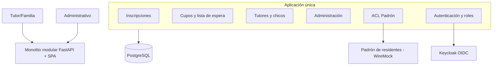

# Documento de arquitectura · TP 6A

> Documento en construcción. Cada sección indica qué falta y en qué issue se completa.

## 1. Escenario

**6A · Colonia de vacaciones · Municipio chico.** Un gobierno ofrece cupos gratuitos en su colonia de
vacaciones para chicos de 6 a 12 años. Las familias inscriben a los chicos en un turno; la asignación es
justa, por orden de llegada, ningún chico puede quedar inscripto dos veces y solo pueden inscribirse
chicos con domicilio en la jurisdicción (se valida contra el padrón de residentes).

| Aspecto | Valor |
|---|---|
| Escala | 600 cupos, unas 1.500 familias, inscripción abierta 3 semanas. Muchas familias se inscriben en la oficina con un administrativo. |
| Quién lo mantiene | Un área de sistemas de una sola persona |
| Infraestructura | Un servidor municipal compartido con otros sistemas |
| NFR estrella | Mantenibilidad y costo |
| Restricción | Se usa 3 semanas al año: al año siguiente se tiene que volver a levantar sin que nadie se acuerde de cómo |

Roles: tutor (inscribe) y administrativo (gestiona cupos y listas). Sistema externo: padrón de residentes.

## 2. NFRs

Pendiente (issue de NFRs). Cada NFR con cómo se mide. La evidencia de verificación va en `docs/NFR.md`.

## 3. Matriz de Pugh

Pendiente (issue de Pugh y C4). Comparar monolito por capas (baseline), monolito modular, microservicios
y orientado a eventos con criterios tomados de los NFRs.

## 4. Estilo

Monolito modular: un solo desplegable y una sola base PostgreSQL, con módulos separados por
responsabilidad ([ADR-001](adr/001-monolito-modular.md)).

## 5. C4 · Contexto y Contenedores

Pendiente (issue de Pugh y C4). Diagramas en draw.io: guardar el `.drawio` y el `.png` en `docs/diagramas/`.

## 6. Dominio

Pendiente: entidades, value objects, agregado raíz e invariantes del caso de uso «un tutor inscribe a un
chico en un turno con cupo disponible».

## 7. Decisiones (ADRs)

| ADR | Decisión |
|---|---|
| [001](adr/001-monolito-modular.md) | Monolito modular |

Plantilla para nuevas decisiones: [000-plantilla.md](adr/000-plantilla.md).

## 8. Verificación de NFRs

Ver `docs/NFR.md` (issue #4).
